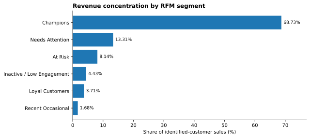
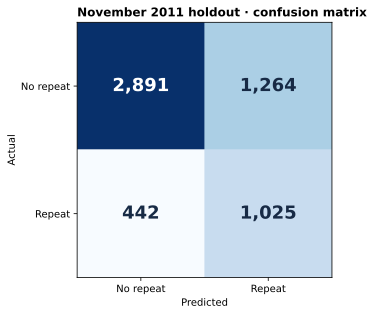

# Customer Intelligence Engine

**E-commerce customer analytics | Python · SQL (DuckDB) · RFM segmentation · Logistic Regression**

An end-to-end analytics portfolio project using the [UCI Online Retail II dataset](https://archive.ics.uci.edu/dataset/502/online+retail+ii). The project explores **what drives sales**, **which customers contribute the most value**, and **how historical purchasing behaviour can inform next-month repeat-purchase predictions**.

[**Read the Business Analysis Report (PDF)**](reports/Customer_Intelligence_Engine_Business_Analysis_Report_Refined.pdf) · [Explore notebooks](notebooks/) · [Explore SQL analyses](sql/)

## Results at a glance

| Business metric | Verified result |
|---|---:|
| Cleaned positive sales revenue | **£19.10M** |
| Recorded orders | **39,238** |
| Identifiable customers in SQL analysis | **5,839** |
| Customers with multiple recorded orders | **72.4%** |
| Champions' share of *identified-customer* sales | **68.73%** |
| Final model ROC-AUC | **0.771** |
| Final model recall / precision | **69.9% / 44.8%** |

> **Revenue scope:** £19.10M represents positive cleaned sales, **not** cancellation-adjusted net revenue. RFM revenue shares use the subset of sales with identifiable customer IDs.

## 1. Business questions

- How do sales, product demand and customer spending vary over time?
- Which customers generate the largest share of historical sales?
- Can behavioural segmentation support more relevant customer engagement?
- Can a transparent model identify customers likely to purchase again next month?

## 2. Sales and customer insights

- **Revenue concentration:** The top 10% of identifiable customers contributed approximately **63.93%** of customer-linked positive sales value in the exploratory analysis.
- **Seasonality:** November was the highest-revenue month in both 2010 (**£1.415M**) and 2011 (**£1.438M**). December 2011 is incomplete and should not be compared as a full month.
- **Repeat purchasing:** **4,226 of 5,839** identifiable customers placed multiple recorded orders (**72.4%**). This is a *historical purchase-frequency measure*, not the machine-learning target.
- **Missing customer identity:** Approximately **13.45%** of cleaned positive sales revenue could not be linked to a customer ID in the SQL analysis.

## 3. Customer segmentation (RFM)

Customers were grouped using **Recency, Frequency and Monetary** measures into six rule-based segments.



| Segment | Customers | Share of identified-customer sales |
|---|---:|---:|
| Champions | 1,250 | 68.73% |
| Needs Attention | 1,167 | 13.31% |
| At Risk | 470 | 8.14% |
| Inactive / Low Engagement | 1,866 | 4.43% |
| Loyal Customers | 576 | 3.71% |
| Recent Occasional | 510 | 1.68% |
| **Total** | **5,839** | **100.00%** |

**Interpretation:** Champions account for approximately **21.4%** of identifiable customers but generate **68.73%** of their recorded positive sales. Segment names describe observed behaviour; they do not prove future value or customer churn.

## 4. Predicting next-month repeat purchases

A **Logistic Regression** model uses four historical customer features: recency, purchase frequency, monetary value and average order value. The project uses time-based train, validation and November 2011 test periods; the **0.20 classification threshold** was chosen using validation results.

| Final November 2011 test metric | Result |
|---|---:|
| Accuracy | 69.7% |
| Precision | 44.8% |
| Recall | 69.9% |
| F1-score | 0.546 |
| ROC-AUC | 0.771 |
| Classification threshold | 0.20 |



The model correctly identified **1,025 of 1,467** actual next-month repeat purchasers, but generated **1,264 false positives**. Its outputs can support *exploratory prioritisation*, not automatic or guaranteed-return marketing decisions. Predicted probabilities have not been calibrated.

## 5. Recommendations

| Priority | Business action | Evidence and intended use |
|---|---|---|
| 1 | Protect high-value customer relationships | Champions contribute 68.73% of identified-customer positive sales; test loyalty and service initiatives |
| 2 | Investigate valuable customers with low predicted repeat likelihood | SQL identifies **224** high-value customers in a low-probability group; review their histories before outreach |
| 3 | Tailor engagement by RFM segment | Use behaviour-based messaging hypotheses, then test effectiveness against a control group |
| 4 | Prepare for seasonal demand | Review inventory and operational capacity ahead of September–November peaks |

These are **recommendations to test**, not measured campaign effects or estimates of recovered revenue.

## 6. Project files

| Analysis stage | Notebook |
|---|---|
| Data understanding | [01_data_understanding.ipynb](notebooks/01_data_understanding.ipynb) |
| Data cleaning | [02_data_cleaning.ipynb](notebooks/02_data_cleaning.ipynb) |
| Exploratory analysis | [03_exploratory_analysis.ipynb](notebooks/03_exploratory_analysis.ipynb) |
| RFM segmentation | [04_customer_segmentation.ipynb](notebooks/04_customer_segmentation.ipynb) |
| Predictive modelling | [05_predictive_modelling.ipynb](notebooks/05_predictive_modelling.ipynb) |

**SQL analyses:** [Sales overview](sql/01_sales_overview.sql) · [Customer revenue](sql/02_customer_revenue.sql) · [Cancellation analysis](sql/03_net_sales.sql) · [Purchase frequency](sql/04_customer_purchase_frequency.sql) · [Monthly trends](sql/05_monthly_sales_trends.sql) · [RFM performance](sql/06_customer_segment_performance.sql) · [Prediction analysis](sql/07_customer_prediction_analysis.sql) · [High-value customers at risk](sql/08_high_value_customers_at_risk.sql)

**Full written report:** [Customer Intelligence Engine — Business Analysis Report (PDF)](reports/Customer_Intelligence_Engine_Business_Analysis_Report_Refined.pdf)

## 7. Technology and data

- **Python:** pandas, NumPy, matplotlib, scikit-learn; Jupyter notebooks
- **SQL:** DuckDB for business-oriented analytical queries
- **Source:** [UCI Machine Learning Repository — Online Retail II](https://archive.ics.uci.edu/dataset/502/online+retail+ii), UK online retail transactions from December 2009 to December 2011
- **Data handling:** Raw and processed datasets are not distributed in this repository; obtain the original workbook from UCI.

### Running the project

1. Download the original UCI workbook to `data/raw/online_retail_II.xlsx`.
2. Create a Python environment and install dependencies:

   ```bash
   python3 -m venv .venv
   source .venv/bin/activate
   python3 -m pip install -r requirements.txt
   ```

3. Open the notebooks in numeric order and review their saved outputs. The SQL files operate on CSVs produced by the notebooks; for example:

   ```bash
   python3 -c "import duckdb; print(duckdb.sql(open('sql/01_sales_overview.sql').read()).df().to_string(index=False))"
   ```

> **Reproducibility note:** The latest SQL outputs use a refined `sales_clean.csv` with **996,980** rows, while the current cleaning notebook's saved result contains **1,007,913** rows. This reconciliation is not yet fully documented, so a clean rerun may not reproduce every reported figure without aligning the cleaning rules and processed files.

## 8. Limitations

- The transactions are historical (2009–2011) and may not reflect today's customer behaviour.
- Missing customer IDs restrict customer-level analysis; positive sales do not equal profit or fully cancellation-adjusted net revenue.
- RFM segment assignments depend on chosen thresholds and business rules.
- Model performance is measured on a single final test month; results may vary over time. The model is not calibrated, and prediction does not demonstrate the causal impact of a marketing campaign.
- The current notebook-to-processed-data discrepancy needs reconciliation before claiming end-to-end reproducibility.

---

**Project focus:** Translating transaction data into clear, testable customer and commercial decisions — with transparent assumptions and limitations.
